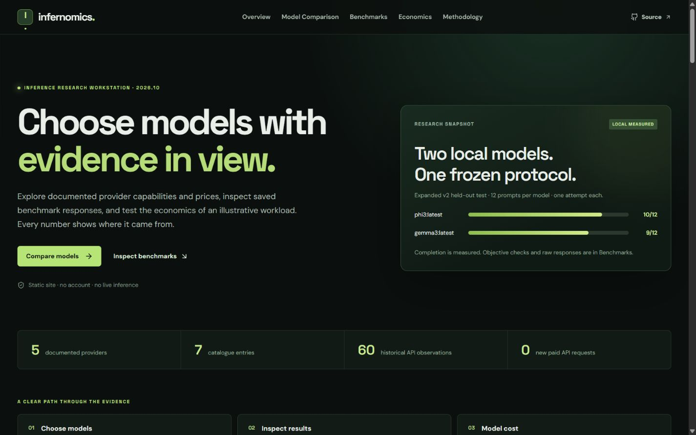
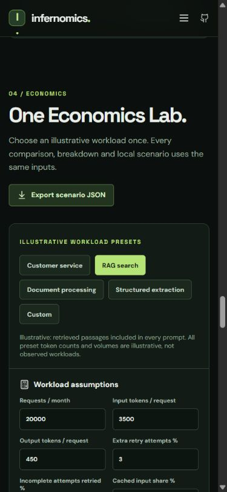
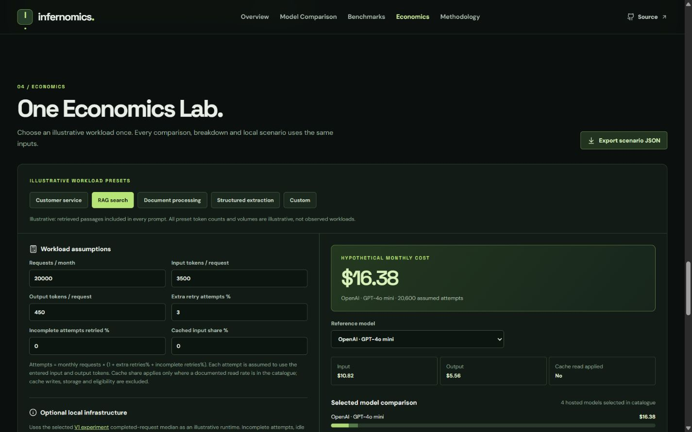
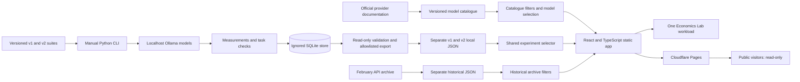

# Infernomics

**Choose models with evidence in view.** Infernomics is a static, inspectable LLM evaluation and economics workstation. Its path is Overview → Model Comparison → Benchmarks → Economics → Methodology. It puts matched model responses, task-specific checks, timing, completion, and cost assumptions beside the evidence that produced them.

[Live site](https://infernomics.nickcloud.dev/) · [Engineering portfolio](https://profile.nickcloud.dev/) · [Case study](docs/CASE_STUDY.md) · [Provider methodology](docs/PROVIDER_METHODOLOGY.md) · [Local methodology](docs/LOCAL_METHODOLOGY.md)

The unified model catalogue covers **OpenAI, Anthropic, Google, xAI and two measured Ollama artifacts**. Provider, modality and evidence filters are generated from the versioned catalogue. One v1/v2 experiment selector controls local response inspection, benchmark summaries and local Economics Lab assumptions. The February GPT-4o-mini archive is accessible within Benchmarks as a separate, single-model study. Anthropic, Google and xAI have no Infernomics performance measurements. The optional Gemini CLI is offline by default and has never been used for this release.



*Locally captured desktop overview of the unified research workstation.*





*Workload presets, rate comparisons and local infrastructure values are illustrative calculations, not measured bills or model performance.*

The Economics Lab has one shared workload form, four illustrative presets plus custom entry, input/output cost breakdowns, documented cache-read and retry scenarios, volume sensitivity, model limits, optional local power and hardware assumptions, and JSON export of assumptions, source URLs and results. The original API calculator and hosted-versus-local form were retired; their valid arithmetic is preserved in the shared calculation modules. [Consolidation decisions](docs/UX_CONSOLIDATION.md) explain the architecture.


*Locally captured 2.0 build, 23 October 2026. The 2.0 site was verified live on the custom domain after [PR #2](https://github.com/QinnniQ/infernomics/pull/2) merged.*

## What the evidence supports

- **Local multi-model study:** one held-out six-prompt suite, two repetitions per prompt, and two already installed Ollama models from different families. Exact responses and deterministic scoring rationale are public in the versioned static snapshot.
- **Historical API archive:** 60 GPT-4o-mini attempts from February 2026 on the same 20 prompts under output caps of 50, 100, and 200 tokens. **28 ended incomplete** at the cap (14, 10, and 4 respectively). The archive is preserved as a separate evidence class.
- **Expanded local suite:** `local_v2.jsonl` has 24 versioned tasks, including 12 held-out prompts across six categories. Its results are published separately from v1; they are not a common score or a provider-wide ranking.
- **Economics:** dated OpenAI, Anthropic, Google and xAI standard text list-price references can be compared for entered token counts, retry volume and documented cache-read assumptions. These are price-only scenarios. Local API fee is zero but electricity and hardware remain unknown until a visitor supplies assumptions. This is not an invoice or production forecast.

The local test is small and synthetic. It demonstrates a controlled methodology and specific model behavior, **not** a universal “best model.” The February API timings cannot be ranked against the local Ollama timings because the hardware, network, prompts, and measurement boundaries differ. Completion is not correctness; subjective answers await human review.


## Original local v1 experiment

On 23 October 2026, `phi3:latest` and `gemma3:latest` each handled six held-out prompts twice. Both completed 10 of 12 attempts, with two output-limit incompletions and no transport errors. Both passed 2 of 6 objective checks; the other six attempts per model were subjective and unscored. Median client wall time among completed attempts was **12,334 ms** for Phi-3 and **26,067 ms** for Gemma 3 (n=10 each). Median Ollama generation throughput was 6.9 and 8.8 model-specific tokens/s respectively (n=10 each). These figures describe this host and protocol, not general deployment performance.

The strict extraction check rejected Markdown-fenced JSON even where the fields inside were correct; the requested output was JSON only. Both models answered the arithmetic test incorrectly. The business task reached the 128-token cap in both repetitions for both models. [Results and limitations](docs/RESULTS_2026-10-23.md) document the experiment ID, artifact digests, denominators, and source-tree caveat.

## Architecture



The public app has no inference backend, database service, visitor API key, or billable compute endpoint. `src/icp/local_benchmark/adapter.py` defines the local Ollama path. `src/icp/provider_adapters.py` contains a dry-run-first Gemini adapter and non-networking Anthropic/xAI stubs; none are bundled into the site. `runner.py` records the artifact digest, settings, dataset hash, host profile, run order, and observations. `store.py` maintains append-only local records and refuses malformed publication. The model catalogue, evidence index, and saved snapshots feed the static React workspace. The original API scripts and archive remain separate. [Architecture and evidence classes](docs/PROVIDER_METHODOLOGY.md) document the boundaries.

## Run the website locally

Node.js 22 or newer is recommended. The committed snapshot works without Python, Ollama, or API keys.

```powershell
cd web
npm ci
npm run dev
```

For release checks from `web`:

```powershell
npm run lint
npm run typecheck
npm test
npm run build
```

`web/dist` is the static deployment output. The existing Cloudflare Pages integration uses `web` as root, `npm run build`, and `dist` as output. It requires no new service or environment variable. The 2.0 homepage and model comparison were verified at [infernomics.nickcloud.dev](https://infernomics.nickcloud.dev/) on 23 October 2026 after the release merged into `main`.

## Run the local benchmark

Ollama must be installed and running on the same Windows machine. The tested host had 16.85 GB RAM, about 58.6 GB free disk, and two models already present: `phi3:latest` (2.2 GB) and `gemma3:latest` (3.3 GB). The command **never pulls models**. Check memory and disk before optionally installing other model tags. Local execution still uses electricity, storage, and CPU/GPU resources.

From the repository root in PowerShell:

```powershell
ollama list
$env:PYTHONPATH = (Resolve-Path .\src).Path
python scripts/run_local_benchmark.py --suite v2 --dry-run
python scripts/run_local_benchmark.py --suite v2 --models phi3:latest gemma3:latest --split test --repetitions 1 --max-output-tokens 128
```

The last command prints an experiment ID and writes `.local/benchmarks.sqlite`, which Git ignores. Inspect the observations, then publish a **specific** held-out experiment into static JSON:

```powershell
python scripts/run_local_benchmark.py --suite v2 --export-id YOUR_EXPERIMENT_ID
python scripts/validate_public_data.py
python scripts/manual_review.py --experiment-id YOUR_EXPERIMENT_ID
```

The v2 export goes to `web/src/data/local-v2-benchmark.json`; the original v1 experiment remains in `local-benchmark.json` and requires `--suite v1` to export. The manual review sheet is private under `.local/reviews/`. Fill all rubric fields, reviewer ID, and rationale; then run `python scripts/manual_review.py --validate .local/reviews/manual-review.jsonl`. These ratings are not currently published. For a different small model family, verify its [tag, size, and license](docs/LOCAL_METHODOLOGY.md), explicitly install it yourself, and pass its exact installed tag to `--models`. No paid provider is used by this path.

### Optional Gemini free-tier path

`python scripts/run_gemini_free.py` is a network-free dry-run. Live execution requires an exact same-day Google AI Studio project attestation, disabled billing, free-tier access to `gemini-3.1-flash-lite`, confirmed remaining quota, a matching API-key fingerprint, and the explicit `--execute-free-tier` flag. The default is one bounded text probe; `--benchmark-v2 --max-requests 12` plans the full held-out suite, with sequential spacing and no retry or paid fallback. Results stay private under `.local/gemini/`. **No Gemini API request was sent for this release.** [Detailed opt-in steps and limits](docs/PROVIDER_METHODOLOGY.md).

Anthropic and xAI inference adapters always raise `PaidInferenceDisabled`; API credentials alone cannot enable them. Promotional credits have not been verified. Consumer chat plans are not API credits. No paid inference was executed, and the site cannot run inference for visitors.

The legacy `scripts/run_sweep.py` invokes the OpenAI API and **can incur charges**. Do not run it as part of this local quickstart or CI. Its archive exporter remains available to verify the February SQLite source when that ignored database is present.

## Methods, cost safeguards, and limits

- The original 18-item synthetic suite is split into development, calibration, and test sets (six per split). The expanded 24-item v2 suite has 12 held-out prompts (two per category). Both were frozen separately on 23 October 2026. Benchmark evaluation is not model training or fine-tuning.
- Ollama reports nanosecond load, prompt, and generation durations and token counts. The Python client independently measures end-to-end wall time. Nonstreaming calls provide **no time to first token**. Throughput uses Ollama's output token count divided by Ollama's generation duration.
- Completed-only latency has an explicit sample count next to incomplete and error counts. Missing data stays null; p95 is withheld at this sample size. Model tokenizers differ.
- Exact, bare-integer, and typed-JSON scoring rules are inspectable. Subjective summaries, technical explanations, and business tasks have review rubrics but no automatic quality score. Strict formats can reject otherwise semantically useful text.
- The historical archive recalculates its recorded tokens with the [OpenAI GPT-4o-mini USD standard text list price](https://developers.openai.com/api/docs/models/gpt-4o-mini) of $0.15 input / $0.60 output per million tokens, first checked 15 October 2026. This is a legacy price reference, not a claim about February invoices. The archived usage did not record cache hits, so its historical cost estimates apply no cache discount. The current Economics Lab separately supports a documented cached-read scenario.
- The current [catalogue](web/src/data/model-catalog.v2.json) contains source-verified standard text references for [Anthropic](https://platform.claude.com/docs/en/about-claude/pricing), [Google](https://ai.google.dev/gemini-api/docs/pricing), [xAI](https://docs.x.ai/developers/pricing) and [OpenAI](https://developers.openai.com/api/docs/models/gpt-4o-mini), checked 23 October 2026. The earlier `hosted-prices.json` remains as a v1 historical artefact and is not used by the current site. No Anthropic, Google or xAI API call or benchmark was performed. Provider tokenizers differ and model quality remains unmeasured in this comparison.
- The local cost scenario asks for power draw, electricity tariff, optional hardware cost, and amortization period. It does not infer ownership or operational cost. The break-even calculation is illustrative and leaves unmeasured costs out explicitly.

[Detailed local methodology](docs/LOCAL_METHODOLOGY.md) · [Baseline audit](docs/BASELINE_AUDIT_2026-10-23.md) · [Legacy experiments](docs/LEGACY_EXPERIMENTS.md) · [Original case study](docs/CASE_STUDY.md)

## Tests and release

CI checks Python unit tests and both evidence snapshots; the web workflow runs `npm audit`, lint, TypeScript, Vitest, and the production build. It never downloads weights or performs inference. The repository also includes small local tests for scorers, the adapter, export rejection, statistics, and economics. Desktop and 390-pixel mobile browser views were inspected against a local Vite build, including model response selection, archive filtering and URL state, and scenario inputs. See [release notes](docs/RELEASE_NOTES.md) for exact check results and remaining limits.


## Planned improvements

Collect independent human ratings for the expanded suite; measure energy and GPU use; capture streaming time to first token; test repeatability across more hosts; and confirm any Gemini free-tier project before a voluntary local run. Any live hosted inference feature would require explicit cost approval, secret management, usage limits, and abuse controls.

Author: Nicholai Gay. The 2.0 implementation was completed with Codex assistance and should be reviewed as such.
