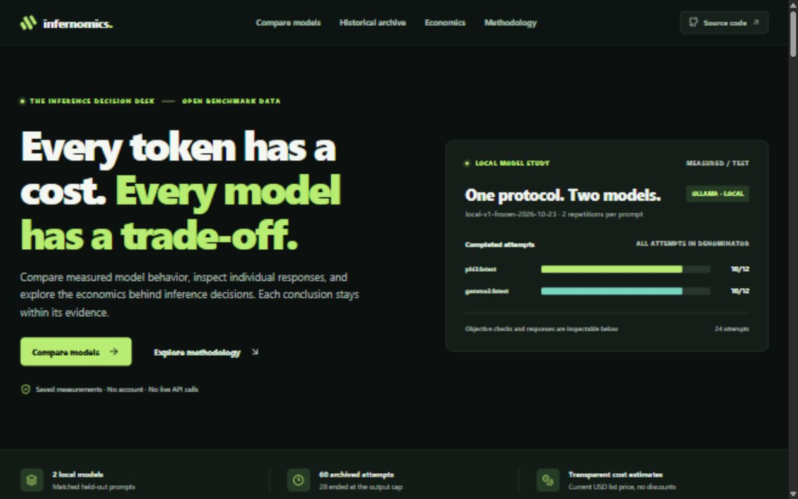
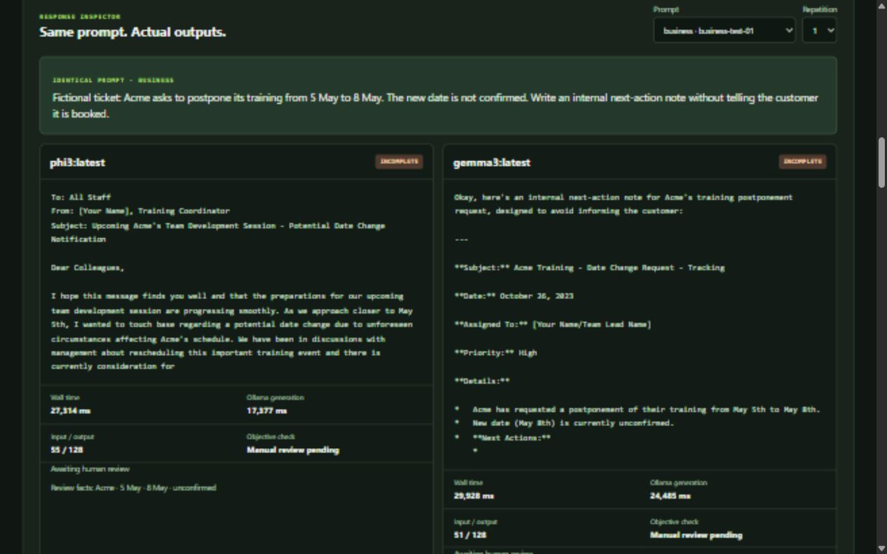
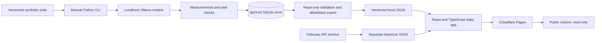
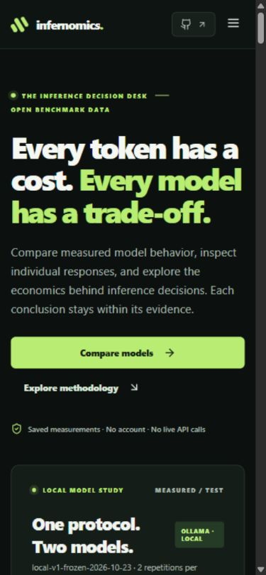

# Infernomics

**Every token has a cost. Every model has a trade-off.** Infernomics is a static, inspectable decision desk for AI inference experiments. It puts matched model responses, task-specific checks, timing, completion, and cost assumptions beside the evidence that produced them.

[Live site](https://infernomics.nickcloud.dev/) · [Engineering portfolio](https://profile.nickcloud.dev/) · [Case study](docs/CASE_STUDY.md) · [Local methodology](docs/LOCAL_METHODOLOGY.md)



*Locally captured 2.0 build, 23 October 2026. The 2.0 site was verified live on the custom domain after [PR #2](https://github.com/QinnniQ/infernomics/pull/2) merged.*

## What the evidence supports

- **Local multi-model study:** one held-out six-prompt suite, two repetitions per prompt, and two already installed Ollama models from different families. Exact responses and deterministic scoring rationale are public in the versioned static snapshot.
- **Historical API archive:** 60 GPT-4o-mini attempts from February 2026 on the same 20 prompts under output caps of 50, 100, and 200 tokens. **28 ended incomplete** at the cap (14, 10, and 4 respectively). The archive is preserved as a separate evidence class.
- **Economics:** dated OpenAI, Anthropic, and Google standard text list-price references can be compared for user-entered token counts. These are price-only scenarios, not measured performance for Claude or Gemini. Local API fee is zero but electricity and hardware remain unknown until a visitor supplies assumptions. This is not an invoice or production forecast.

The local test is small and synthetic. It demonstrates a controlled methodology and specific model behavior, **not** a universal “best model.” The February API timings cannot be ranked against the local Ollama timings because the hardware, network, prompts, and measurement boundaries differ. Completion is not correctness; subjective answers await human review.



## Verified local experiment

On 23 October 2026, `phi3:latest` and `gemma3:latest` each handled six held-out prompts twice. Both completed 10 of 12 attempts, with two output-limit incompletions and no transport errors. Both passed 2 of 6 objective checks; the other six attempts per model were subjective and unscored. Median client wall time among completed attempts was **12,334 ms** for Phi-3 and **26,067 ms** for Gemma 3 (n=10 each). Median Ollama generation throughput was 6.9 and 8.8 model-specific tokens/s respectively (n=10 each). These figures describe this host and protocol, not general deployment performance.

The strict extraction check rejected Markdown-fenced JSON even where the fields inside were correct; the requested output was JSON only. Both models answered the arithmetic test incorrectly. The business task reached the 128-token cap in both repetitions for both models. [Results and limitations](docs/RESULTS_2026-10-23.md) document the experiment ID, artifact digests, denominators, and source-tree caveat.

## Architecture



The public app has no inference backend, database service, visitor API key, or billable compute endpoint. `src/icp/local_benchmark/adapter.py` defines the provider-neutral adapter contract and implements only the local Ollama HTTP path. `runner.py` records the model digest, settings, dataset hash, host profile, run order, and observations. `evaluation.py` applies narrow objective checks. `store.py` maintains append-only local records and refuses malformed publication. `web/src/lib/local.ts` validates the bundled snapshot and computes transparent summaries; `web/src/components/LocalComparison.tsx` renders model selection, completion chart, and matched responses. The original API scripts and archive remain separate.

## Run the website locally

Node.js 22 or newer is recommended. The committed snapshot works without Python, Ollama, or API keys.

```powershell
cd web
npm ci
npm run dev
```

For release checks from `web`:

```powershell
npm run lint
npm run typecheck
npm test
npm run build
```

`web/dist` is the static deployment output. The existing Cloudflare Pages integration uses `web` as root, `npm run build`, and `dist` as output. It requires no new service or environment variable. The 2.0 homepage and model comparison were verified at [infernomics.nickcloud.dev](https://infernomics.nickcloud.dev/) on 23 October 2026 after the release merged into `main`.

## Run the local benchmark

Ollama must be installed and running on the same Windows machine. The tested host had 16.85 GB RAM, about 58.6 GB free disk, and two models already present: `phi3:latest` (2.2 GB) and `gemma3:latest` (3.3 GB). The command **never pulls models**. Check memory and disk before optionally installing other model tags. Local execution still uses electricity, storage, and CPU/GPU resources.

From the repository root in PowerShell:

```powershell
ollama list
$env:PYTHONPATH = (Resolve-Path .\src).Path
python scripts/run_local_benchmark.py --dry-run
python scripts/run_local_benchmark.py --models phi3:latest gemma3:latest --split test --repetitions 2 --max-output-tokens 128
```

The last command prints an experiment ID and writes `.local/benchmarks.sqlite`, which Git ignores. Inspect the observations, then publish a **specific** held-out experiment into static JSON:

```powershell
python scripts/run_local_benchmark.py --export-id YOUR_EXPERIMENT_ID
python scripts/validate_public_data.py
python scripts/manual_review.py --experiment-id YOUR_EXPERIMENT_ID
```

The manual review sheet is private under `.local/reviews/`. Fill all rubric fields, reviewer ID, and rationale; then run `python scripts/manual_review.py --validate .local/reviews/manual-review.jsonl`. These ratings are not currently published. For a different small model family, verify its [tag, size, and license](docs/LOCAL_METHODOLOGY.md), explicitly install it yourself, and pass its exact installed tag to `--models`. No paid provider is used by this path.

The legacy `scripts/run_sweep.py` invokes the OpenAI API and **can incur charges**. Do not run it as part of this local quickstart or CI. Its archive exporter remains available to verify the February SQLite source when that ignored database is present.

## Methods, cost safeguards, and limits

- The 18-item synthetic suite is split into development, calibration, and test sets (six items per split across six categories). The held-out test was frozen on 23 October 2026. Benchmark evaluation is not model training or fine-tuning.
- Ollama reports nanosecond load, prompt, and generation durations and token counts. The Python client independently measures end-to-end wall time. Nonstreaming calls provide **no time to first token**. Throughput uses Ollama's output token count divided by Ollama's generation duration.
- Completed-only latency has an explicit sample count next to incomplete and error counts. Missing data stays null; p95 is withheld at this sample size. Model tokenizers differ.
- Exact, bare-integer, and typed-JSON scoring rules are inspectable. Subjective summaries, technical explanations, and business tasks have review rubrics but no automatic quality score. Strict formats can reject otherwise semantically useful text.
- Hosted costs use the [OpenAI GPT-4o-mini USD standard text list price](https://developers.openai.com/api/docs/models/gpt-4o-mini) recorded as $0.15 input / $0.60 output per million tokens, checked 15 October 2026. The model is a legacy price reference, not a claim about the February invoices. No caching, batch discount, tax, tool charge, or tokenization difference is built into that price.
- The scenario also shows source-verified standard text price references for [Anthropic Claude](https://platform.claude.com/docs/en/about-claude/pricing) and [Google Gemini](https://ai.google.dev/gemini-api/docs/pricing), checked 23 October 2026 and versioned in `web/src/data/hosted-prices.json`. No Anthropic or Google API call or benchmark was performed. Assuming identical token counts across providers does not mean identical text would tokenize identically; model capabilities and quality remain unmeasured in this comparison.
- The local cost scenario asks for power draw, electricity tariff, optional hardware cost, and amortization period. It does not infer ownership or operational cost. The break-even calculation is illustrative and leaves unmeasured costs out explicitly.

[Detailed local methodology](docs/LOCAL_METHODOLOGY.md) · [Baseline audit](docs/BASELINE_AUDIT_2026-10-23.md) · [Legacy experiments](docs/LEGACY_EXPERIMENTS.md) · [Original case study](docs/CASE_STUDY.md)

## Tests and release

CI checks Python unit tests and both evidence snapshots; the web workflow runs `npm audit`, lint, TypeScript, Vitest, and the production build. It never downloads weights or performs inference. The repository also includes small local tests for scorers, the adapter, export rejection, statistics, and economics. Desktop and 390-pixel mobile browser views were inspected against a local Vite build, including model response selection, archive filtering and URL state, and scenario inputs. See [release notes](docs/RELEASE_NOTES.md) for exact check results and remaining limits.



## Planned improvements

Add a broader, independently reviewed task suite; collect and reconcile multiple human ratings; measure energy and GPU use with appropriate tools; capture streaming time to first token; and test repeatability across more hosts and runs. Any live hosted inference feature would require explicit cost approval, secret management, usage limits, and abuse controls.

Author: Nicholai Gay. The 2.0 implementation was completed with Codex assistance and should be reviewed as such.
