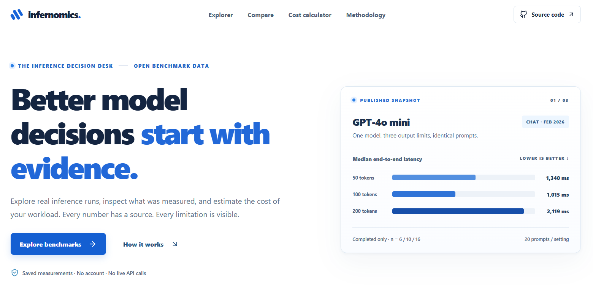
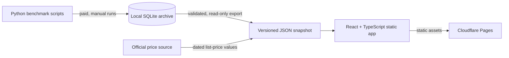

# Infernomics

Infernomics is a static decision desk for inspecting archived LLM inference runs. It connects measured latency and token use to a clearly labeled cost estimate, then shows the exact responses behind each point. The first public snapshot has **one model and three output-token settings**, so it supports a configuration comparison, not a cross-model recommendation.

- **Live site:** [infernomics.nickcloud.dev](https://infernomics.nickcloud.dev/) ([Cloudflare Pages URL](https://infernomics.pages.dev/))
- **Source repository:** https://github.com/QinnniQ/infernomics
- **Status:** deployed on Cloudflare Pages; the custom domain and served app HTML were verified on 15 October 2026.

[Nicholai Gay's AI engineering portfolio](https://profile.nickcloud.dev/) · [LinkedIn](https://www.linkedin.com/in/nicholai-gay-201905148/)



*The deployed Infernomics homepage, October 2026.*

## What is available

- Explore three real chat sweep runs (60 attempts) from 18 February 2026 with filterable and sortable results, a chart, accessible table, run details, and shareable URL parameters.
- Compare two or three matched runs side by side for the same prompt. The controlled setting is the maximum output-token cap (50, 100, 200).
- Estimate monthly USD text-token spend at an official price checked on 15 October 2026. The app performs no provider calls.
- Inspect the methodology and limitations in the UI and in this README.

The saved OpenAI Responses API records resolve `gpt-4o-mini` to `gpt-4o-mini-2024-07-18`. Of the 60 attempts, 28 returned `status=incomplete` with reason `max_output_tokens`: 14/20 at cap 50, 10/20 at cap 100, and 4/20 at cap 200. The runner did not count these as transport errors. Infernomics distinguishes **completed**, **incomplete**, and **error** outcomes. It reports median latency only for completed responses, with its sample count. Mean estimated cost uses all attempts with recorded token use because incomplete responses can still consume tokens.

## Architecture



The public path is static and needs no runtime secret, database, worker, or paid inference. Python and SQLite stay in the offline benchmark workflow. The exporter reads the ignored local database, verifies matching prompts and response settings, and writes only public fields to `web/src/data/benchmark.json`. It excludes raw provider response metadata and the archived `cost_estimate` field.

## Run locally

Requirements: Node.js 22 or newer; Python 3.13 for the pinned benchmark environment. The core Python package declares 3.10+, but this lockfile was verified on 3.13 only.

```powershell
cd web
npm ci
npm run dev
```

Open the URL Vite prints. A fresh checkout needs no API key or SQLite database because the audited JSON snapshot is committed. For a release build:

```powershell
cd web
npm ci
npm run lint
npm run typecheck
npm test
npm run build
```

`web/dist` is the deployable output. The app has no environment variables. Its data and prices are intentionally versioned at build time; refresh them through review and redeploy, then update the visible verification date.

## Data provenance and calculations

The source archive is `outputs/results.sqlite`, ignored by Git. Three run IDs are published in the JSON and run detail UI. All 20 prompts match `data/eval_sets/chat_prompts.jsonl` in order; the export includes its SHA-256 hash. Each published item retains the prompt, response, index, token counts, request latency, completion status, and any incomplete reason. The archived records do **not** contain a reliable price source, prompt-template version, full generation settings, retry count, or code commit for the February execution. Four older chat runs also lack a recorded output cap and are intentionally excluded.

The elapsed latency was measured with `time.perf_counter()` immediately around `client.responses.create()`, so it includes network and service time. It is **end-to-end SDK call wall time**, not time to first token. The median is calculated only across completed responses; the displayed `n` makes that denominator explicit. No p95 is shown for this small sample.

There was **no chat quality evaluation** for these runs. Completion is not a quality score. The separately archived RAG judge CSV is retained locally but omitted from the public comparison: it evaluates a different task and stores only aggregate results with weaker provenance. There is no universal best-model score or quality threshold recommendation.

Estimated request cost = `(recorded input tokens × input list price + recorded output tokens × output list price) / 1,000,000`. Monthly estimate multiplies that expression by the entered request count; “per day” uses 30 days. The current `gpt-4o-mini` standard text price is **$0.15 input / $0.60 output per million tokens**, checked 15 October 2026 from [official OpenAI documentation](https://developers.openai.com/api/docs/models/gpt-4o-mini). This is a **current USD list-price estimate**, not a reconstruction of 2026-02 invoices. Caching, batch discounts, tax, tools, retries, and other charges are excluded. The legacy Python pricing table contains approximate EUR values and must not be confused with the published USD estimates.

## Reproduce or extend benchmark work

The public app never runs paid inference. The original Python scripts remain for local experimentation. They require an OpenAI API key and can incur charges; check current model availability and prices before use. The model used in this archive is marked deprecated in [official OpenAI documentation](https://developers.openai.com/api/docs/models/gpt-4o-mini).

```powershell
python -m venv .venv
.\.venv\Scripts\Activate.ps1
pip install -r requirements.lock.txt
pip install -e . --no-deps
Copy-Item .env.example .env
# Put your own OPENAI_API_KEY in .env; never commit it.
python scripts/run_sweep.py
python scripts/export_public_benchmark.py
```

`run_sweep.py` uses the 20 prompts in `data/eval_sets/chat_prompts.jsonl` and caps `[50, 100, 200]`. It now records the dataset and runner file hashes in new run metadata; the February archive cannot be retroactively enriched. The exporter is intentionally pinned to exactly one run per cap in the local archive and will refuse an ambiguous or mismatched database. For a new dataset or model, update the exporter, inspect status and provenance, then publish a new reviewed snapshot. Do not overwrite the included historical result with generated examples.

The legacy RAG and caching scripts are exploratory. The Streamlit dashboard (`streamlit_app.py`) remains in the repository as an archive viewer; its old cost labels and CSV summaries are **not** the published evidence or release UI.

The earlier Python experiment guide, including its screenshot interpretation and limitations, is preserved in [Legacy experiments](docs/LEGACY_EXPERIMENTS.md). Its [synthetic offline fixture](examples/sample_topk_fixture.json) can still be regenerated with `python scripts/reproduce_sample.py`; it is not part of the measured web snapshot.

## Cloudflare Pages deployment

The site is deployed from the `main` branch to [infernomics.nickcloud.dev](https://infernomics.nickcloud.dev/) through Cloudflare Pages Git integration. Cloudflare's [React Pages guide](https://developers.cloudflare.com/pages/framework-guides/deploy-a-react-site/) specifies `npm run build` and `dist`; the [Pages pricing documentation](https://developers.cloudflare.com/pages/functions/pricing/) says static asset requests are free and unlimited on both free and paid plans. The release uses only static Pages hosting. Python's OpenAI, NumPy, SQLite, and local file workloads stay outside request handling. Cloudflare's [Pages limits](https://developers.cloudflare.com/pages/platform/limits/) currently include 500 builds/month on Free, 20,000 files per site, and 25 MiB per asset; this build is well below the file and size limits.

Current Git integration settings:

| Setting | Value |
| --- | --- |
| Repository | `QinnniQ/infernomics` |
| Root directory | `web` |
| Build command | `npm run build` (Pages installs from the lockfile) |
| Output directory | `dist` |
| Environment variables | None |

`web/wrangler.toml` names the Pages project and its `dist` output. Cloudflare built commit `58020f7` with Node.js 22.16.0 and reported a successful deployment. The `*.pages.dev` URL and custom domain returned HTTP 200; public DNS resolved the custom domain, and its HTML contained the expected Infernomics title and app assets. These checks verify delivery, not every browser interaction. No deployment credentials are stored here. Pushes to `main` trigger a new Pages build. Roll back in Cloudflare Pages by selecting the previous successful deployment, or revert the Git commit and redeploy. Because data is bundled with the build, rolling back code also rolls back the data snapshot and displayed price verification date.

**No live inference is exposed.** If it is ever added, it needs server-side credentials, input/output bounds, rate and concurrency limits, timeouts, usage logs that exclude submitted prompts by default, an operational disable switch, and provider-side spending alerts. Application counters alone cannot guarantee a hard cap under concurrent traffic or delayed provider reporting.

## Verification and limits

CI runs lint, TypeScript checking, tests, and a production build. Unit tests cover snapshot validation, median, pricing, filtering, comparison compatibility, and incomplete counts. The public site has keyboard-focus styles, semantic controls, chart text alternatives, a results table, and reduced-motion support. See `docs/RELEASE_NOTES.md` for recorded local check results and remaining work.

The existing [Python test workflow](.github/workflows/tests.yml) checks the benchmark and pricing paths separately.

The current evidence does **not** answer “which LLM is best” across providers: one model, a small nonrepresentative prompt set, missing quality scores, and incomplete generation controls preclude that claim. It does show why cost and latency alone are insufficient when a low output limit truncates many responses.

## Portfolio materials

- [Engineering case study](docs/CASE_STUDY.md)
- [Demo script and verified CV/LinkedIn copy](docs/PORTFOLIO.md)
- [Release checks and progress](docs/RELEASE_NOTES.md)

Author: Nicholai Gay.
