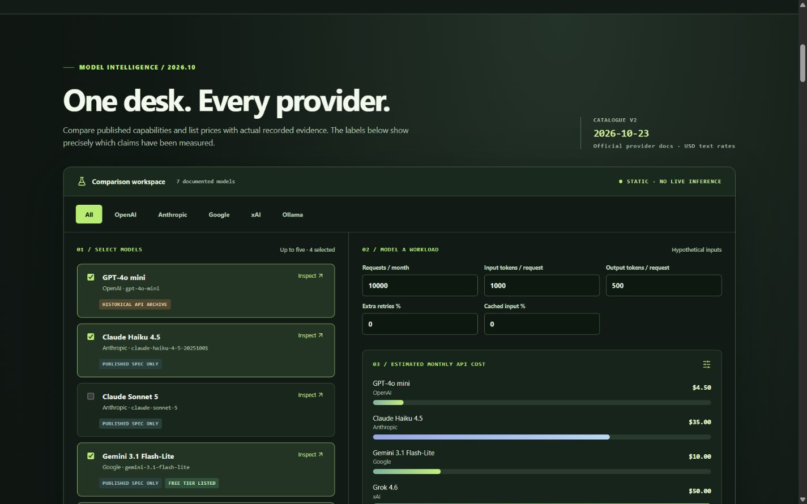

# Engineering case study: Infernomics

## Provider-independent extension — October 2026

The central product interaction is now a source-backed comparison of seven model entries across OpenAI, Anthropic, Google, xAI and local Ollama. Every entry has a precise ID, published capability and price claims where applicable, first-party links, and a verification date. The visitor can filter by provider, select models, change a workload, inspect a cost chart and see why a figure is measured, published or hypothetical. The public Cloudflare app remains a static bundle with no credentials or live inference route.

The main engineering decision was to preserve evidence boundaries. The original 60-attempt GPT-4o-mini archive and 24-attempt Ollama v1 study remain intact. A new 24-attempt Ollama v2 study doubles held-out prompt coverage from six to twelve tasks across the same six categories. In v2, Phi-3 completed 10/12 and passed 3/6 objective checks; Gemma 3 completed 9/12 and passed 2/6. Six further tasks per model require human review. [V2 results](RESULTS_LOCAL_V2_2026-10-23.md) give denominators and limitations. The task sets differ, so v1 and v2 are not pooled.

The price model uses official text list rates and applies a documented xAI long-context threshold and optional cache-read rates. Equal entered token counts are a scenario assumption because tokenizers differ. The interface does not assign synthetic quality or speed to untested commercial models. An optional Google adapter is dry-run first and requires an exact, same-day free-tier project and API-key attestation before one local call. Paid Anthropic and xAI adapters always reject execution. No paid API expenditure or new hosted request occurred during this release. [Provider methodology](PROVIDER_METHODOLOGY.md) describes the contracts and trade-offs.

*The model list distinguishes the historical OpenAI archive, local measurements, and published specifications. Cost bars use a visitor-entered workload.*

## 2.0 extension — October 2026

The original case study below explains the 1.0 API archive. The 2.0 extension adds a **separate** local Ollama experiment rather than reinterpreting those historical API measurements. The product question is now which model and setting fit a particular workload across task outcome, completion, latency, and cost assumptions.

The new held-out study ran two installed model families, `phi3:latest` and `gemma3:latest`, on six synthetic prompts with two repetitions. Each completed 10/12 attempts and passed 2/6 narrow objective checks. Both extraction responses wrapped otherwise matching JSON fields in Markdown fences, and both arithmetic responses were incorrect. Subjective tasks remain unscored. These are specific observations on one host, not an overall quality ranking. [Verified results](RESULTS_2026-10-23.md) provide model digests and denominators.

The design changed in three important ways: (1) a localhost-only adapter and manual runner capture artifact digests, dataset hash, generation settings, warmups, shuffled execution order, and separate client/server timings; (2) an append-only ignored SQLite store and read-only publication gate reject mismatched prompts, missing coverage, and corrupt metrics; (3) a dark React comparison view shows matched raw responses and objective rationale while the 60-attempt API archive stays explicit. The public site still runs no inference. Local electricity is unavailable until power and tariff assumptions are entered. [Local methodology](LOCAL_METHODOLOGY.md), [baseline audit](BASELINE_AUDIT_2026-10-23.md), and [architecture in the README](../README.md#architecture) describe the tradeoffs.

The economics view also carries dated [OpenAI](https://developers.openai.com/api/docs/models/gpt-4o-mini), [Anthropic](https://platform.claude.com/docs/en/about-claude/pricing), and [Google](https://ai.google.dev/gemini-api/docs/pricing) standard text prices as a separate reference class. It applies a visitor's hypothetical token counts and request volume to each rate. It does not claim Claude or Gemini task performance, and no paid API request was made.

### Original 1.0 archive case study

## Problem

Cost, latency, completion, and answer quality all matter when selecting an LLM configuration. The original repository collected useful Python experiments but presented archived CSVs in a Streamlit dashboard with unsupported cost and quality comparisons. A portfolio visitor had no fast way to inspect the underlying responses or understand what had actually been measured.

## Evidence assessment

The SQLite archive contains seven chat runs (140 items), all for `gpt-4o-mini`. Three runs record the same 20-prompt dataset and output limits of 50, 100, and 200 tokens. The provider response metadata identifies the resolved snapshot. Four older runs omit the output cap. The RAG judge CSV has aggregate scores for a different task and cannot support side-by-side chat response comparison. No chat quality evaluation or historical pricing source exists.

The checked-in chat runner imported a nonexistent `estimate_cost`, preventing new runs until corrected. The archived `cost_estimate` fields are zero; their original cause is unknown, so we did not treat them as evidence. The old summaries also missed provider-level incomplete statuses. Inspecting those statuses revealed that 28 of 60 documented sweep attempts were incomplete at the output cap. This changed the product narrative: the smallest cap looks cheap and fast but completes only six of 20 prompts.

## Decisions and trade-offs

1. **Publish a static, curated snapshot.** A read-only exporter validates matching prompts, model alias, resolved snapshot, and cap. It emits the minimum needed per-item fields and omits raw provider metadata. Static Cloudflare Pages hosting makes the public app useful with zero provider calls.
2. **Separate observed and derived values.** Token use, latency, status, and response text are archived observations. USD request cost is recalculated from a dated official list price. The workload calculator uses the same formula, with no automatic discount.
3. **Compare conditions honestly.** The comparison accepts matched runs on one model snapshot and dataset. It presents side-by-side response text and visibly unavailable quality. It does not rank models or normalize unrelated RAG judge scores.
4. **Keep latency denominators visible.** The median uses completed responses only and shows its sample count. Incomplete counts stay adjacent, since excluding them can bias apparent speed.
5. **Keep Python offline.** NumPy, SQLite, local files, and paid provider calls remain in manually run benchmark scripts. No account, server, or request-time inference is needed for the public release.

## Result and next evidence milestone

The implemented UI offers an explorer, exact run inspection, matched-prompt comparison, and monthly cost estimate with source and assumptions. It is designed to let a visitor understand the project quickly while preserving enough detail for an engineer to audit calculations.

*The live site's homepage introduces the decision workflow and labels the one-model benchmark snapshot.*

This was the next milestone identified at the 1.0 release. The 2.0 local study above adds two model artifacts, versioned prompts, generation settings, and narrow task-appropriate scoring. Broader cross-model recommendations still require more prompts, repeat runs, and independent human review.
