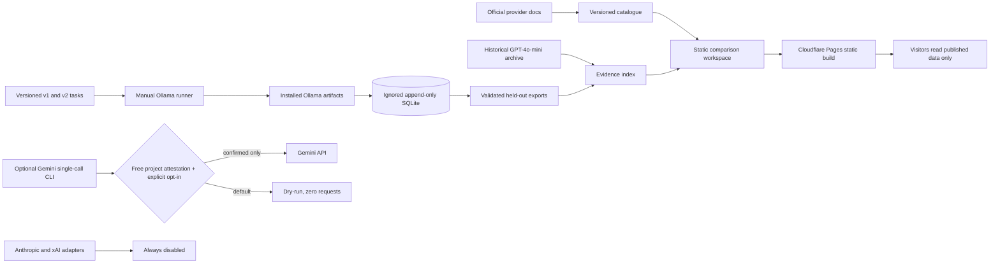

# Provider comparison methodology · catalogue v2

Verified 23 October 2026. The [versioned catalogue](../web/src/data/model-catalog.v2.json) contains exact API IDs or installed Ollama tags, price units, capability limits, first-party source URLs and claim-level verification dates. Providers can change prices, aliases, limits and availability; this snapshot is not a live quote.

## Four evidence classes

The [evidence index](../web/src/data/evidence-index.v1.json) distinguishes:

| Class | Meaning | Current records |
| --- | --- | --- |
| Local measurement | Actual client and Ollama timing, token counts, status and saved response on one host | v1 and expanded v2 Ollama experiments |
| Hosted API measurement | Actual saved hosted request outcomes | February 2026 GPT-4o-mini archive only; Gemini has zero requests |
| Published provider specification | Provider-documented ID, rate, modalities or token limit | Catalogue v2, seven entries |
| Hypothetical cost calculation | Browser arithmetic using entered workload and published list prices | Interactive scenarios; never a bill or benchmark |

No quality, response, latency or throughput is imputed to Anthropic, xAI or Google. The February OpenAI archive has 60 requests across 20 prompts and three output caps, 28 incomplete. It does not share tasks, host, or measurement boundary with the local experiments. It cannot be ranked against them for speed or quality.

## Price calculation

For each hosted model, requests × (1 + retry %) × input tokens × input price / 1,000,000, plus the corresponding output amount. The workspace can substitute a documented cached-input **read** price for a user-entered fraction; zero is the default. It does not assume cache hits happen automatically. Cache writes, storage, tool use, batch discounts, taxes, priority service and region premiums are excluded. xAI Grok 4.6 switches *all* input and output tokens to its documented long-context tier at 200,000 input tokens; the catalogue records its long-context cache-read rate too. Workloads beyond documented input+output or output limits have no estimate. The separate local economics panel models electricity only when the visitor supplies draw and tariff. Zero Ollama API fee does not mean zero operating cost.

These inputs are **token-count assumptions**. Provider tokenizers differ, so equal entered counts do not represent the same actual text or invoice. Gemini's displayed $0.25/$1.50 rates are its **paid-tier** standard text rates for `gemini-3.1-flash-lite`; Google's price page separately lists free-tier input and output as free of charge for eligible projects. Output charges include thinking tokens. The free-tier claim does not make every project or key eligible.

Sources: [OpenAI GPT-4o-mini](https://developers.openai.com/api/docs/models/gpt-4o-mini), [Anthropic models](https://platform.claude.com/docs/en/models/overview) and [pricing](https://platform.claude.com/docs/en/about-claude/pricing), [Google model](https://ai.google.dev/gemini-api/docs/models/gemini-3.1-flash-lite), [pricing](https://ai.google.dev/gemini-api/docs/pricing) and [billing](https://ai.google.dev/gemini-api/docs/billing), [xAI pricing](https://docs.x.ai/developers/pricing) and [release notes](https://docs.x.ai/developers/release-notes), [Ollama Phi-3](https://ollama.com/library/phi3) and [Gemma 3](https://ollama.com/library/gemma3). The precise claims tied to each source are in the JSON catalogue.

## Optional hosted adapters and spend control

`AnthropicAdapter` and `XAIAdapter` are intentionally non-networking stubs that always raise `PaidInferenceDisabled`, including when credentials are present. Promotional credits are **unverified** because no account or credit balance was accessed. A consumer chat subscription is not API credit. No paid requests or automatic top-ups are part of this release.

`GeminiFreeTierAdapter` is dry-run by default. It permits exactly the documented free-tier model ID `gemini-3.1-flash-lite`, text-only input, at most 128 output tokens per call, no tools and no retries. To send any local API request, an operator must:

1. Confirm in [Google AI Studio](https://aistudio.google.com/) that the exact project is **Free**, billing is **Disabled**, `gemini-3.1-flash-lite` is available, and its remaining quota is sufficient. Google applies limits per project and they change; the adapter does not infer eligibility from a consumer plan.
2. Put this local, ignored file at `.local/gemini-free-tier-attestation.json`, with today's date and the SHA-256 fingerprint of the *same project API key*:

   ```json
   {"project_id":"EXACT_PROJECT_ID","model":"gemini-3.1-flash-lite","verified_on":"YYYY-MM-DD","tier":"Free","billing":"Disabled","model_available":true,"api_key_sha256":"64_HEX_CHARACTERS","remaining_requests_today":12}
   ```

3. Run `python scripts/run_gemini_free.py --project-id EXACT_PROJECT_ID` for a network-free single-probe dry-run, or add `--benchmark-v2 --max-requests 12` to plan the complete held-out suite. Only if personally satisfied with the account evidence, set `GEMINI_API_KEY` locally and add `--execute-free-tier`. The script does not persist the key or enable billing. A benchmark run uses at most the explicitly capped, attested remaining request count, spaces requests by 65 seconds, never retries, and writes observations only under ignored `.local/gemini/`. A run with fewer than 12 tasks is partial and is not a matched comparison.

The attestation is a deliberate operator assertion, not an API-verified billing guarantee. The code checks project ID, key fingerprint, model, free tier, disabled billing, availability and same-day verification before constructing the request. There is no paid fallback if quota is exhausted. Do not commit the attestation or key. No such confirmation was supplied for this release, so Gemini remains unmeasured.

## Evaluation scope

The original `local_v1.jsonl` and its public snapshot are unchanged. The expanded `local_v2.jsonl` is frozen separately with 24 synthetic tasks: six development, six calibration and **12 held-out test items** (two per category). Objective instructions use exact-string checks, arithmetic uses bare-integer checks, and extraction uses typed JSON fields. Summarization, technical explanations and business communication retain explicit human-review facts and **no automatic quality score**. A strict format failure may still be a useful answer in another context. Repetitions, completion and assessed denominators are reported with each experiment. V1 and v2 scores use different tasks and cannot be pooled. This is a small single-host study, with no human ratings yet, no time to first token, energy meter, GPU profile or p95 claim.

## Architecture



The browser has no credentials, inference endpoint, server database or visitor-triggered request path. Local benchmark and optional Gemini CLI code never runs in the Cloudflare build.
