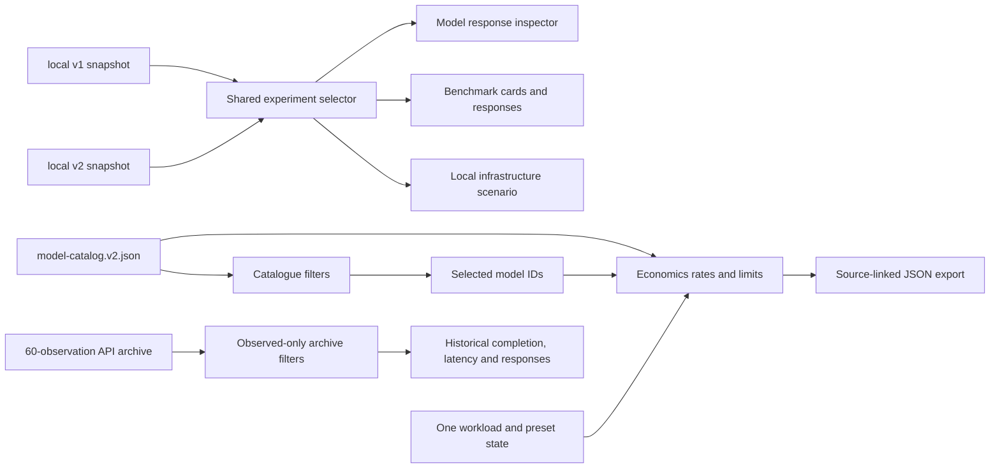

# Product consolidation · 23 October 2026

## Audit and decision

The previous page repeated the same cost inputs in three places: provider workspace, historical OpenAI calculator and hosted-versus-local scenario. Its local comparison used v1 while the workspace defaulted to v2. The historical explorer exposed provider, model and task dropdowns with only one value each. This made the page read as several prototypes and risked comparing incompatible local denominators.

The rebuilt **frontend presentation layer** follows Overview → Model Comparison → Benchmarks → Economics → Methodology. Python runners, the append-only local store, validated JSON exports, the Gemini gate, CI and Cloudflare Pages remain in place. The historical archive and both Ollama snapshots are unchanged. Retired React components and styles were removed after replacing their interactions.

## Shared state and data flow

`web/src/lib/data.ts` validates each static input once. `web/src/lib/platform.ts` contains provider/modality/evidence filtering, model-selection limits, observed archive choices, suite selection, presets, quantiles, scenario calculation and export. `main.tsx` owns the selected model IDs, local suite and workload, passing those values into the three visible work areas. There is one workload form. Selecting v1 or v2 changes local results and local economic runtime together; it never merges datasets.

The archive's cap, completion, prompt and run controls are built from recorded observations. Completion bars show completed/all attempts. Completed-only latency uses min, interpolated Q1, median, interpolated Q3 and max with sample count. A prompt can be inspected at each recorded cap. No archive control promises a provider, model or category absent from the data.

## Economics contract

Every preset is an illustrative workload, not observed traffic. Requests, input tokens, output tokens, extra retries, incomplete retries and cache-read share are explicit. Attempts are `requests × (1 + extra_retry_pct/100 + incomplete_retry_pct/100)`. Input and output charges use the current, sourced USD per-million standard text rates. xAI's ≥200k-input tier applies to all tokens when triggered. The estimator returns no hosted number outside documented context or output limits. Cache discounts are substituted only for documented, modeled read rates; Google caching is omitted because storage costs are separate. All cache-write, storage, batch, tool, regional, tax and non-text charges remain outside the estimate. The interface shows input/output bars, 0.5×/1×/2× volume sensitivity, cache scenarios and an optional local electricity/hardware illustration. Full local ownership cost is unknown.

The exported JSON records inputs, selected experiment version, model IDs, catalogue version, verification date, source URLs, calculated outputs and limitations. It makes an assumption set reproducible without labeling an estimate as a bill or embedding credentials.

## Scientific limits

The local v1 and v2 task sets differ and have different repetitions. The February API archive used a different prompt set, host and timing boundary. Claude, Gemini and Grok have published specs and price scenarios but no Infernomics performance samples. Objective local checks cover only six tasks per model per suite; other answers await human review. Historical quality is unscored. Small samples do not establish general quality, p95 latency or model superiority.

## Release verification

The relevant official [OpenAI](https://developers.openai.com/api/docs/models/gpt-4o-mini), [Anthropic](https://platform.claude.com/docs/en/about-claude/pricing), [Google](https://ai.google.dev/gemini-api/docs/pricing) and [xAI](https://docs.x.ai/developers/pricing) rate pages were rechecked on 23 October 2026. The catalogue now records GPT-4o-mini and Sonnet 5 cached-read rates. No provider inference API was called. Automated checks cover catalogue filters and selection, suite provenance, archive filters and counts, retry arithmetic, cache behavior, context limits, xAI long context and exported assumptions. Desktop at 1440 px and mobile at 390 px were inspected in a browser; the archive filters, shared v1 selection and RAG preset were exercised in the UI.
